<div align="center">



### WPA/WPA2/WPA3 Capture Analyzer · Hash Extractor · Decryptor · Enterprise Credential Extraction

> ⚠️ **For authorized security research and education only** — penetration
> testing engagements, red team exercises, and CTF/lab environments you
> have explicit permission to test. See [Disclaimer](#disclaimer).

</div>


**Wiforge** is a single-file Python CLI, built for **security researchers,
penetration testers, and CTF players**, for working with 802.11 (Wi-Fi) packet
captures end to end: it finds WPA/WPA2/WPA3 networks and handshakes in a
`.cap`/`.pcap`/`.pcapng` file, extracts crackable hashes for them, and —
once you have a password — decrypts the actual traffic and pulls out a
full packet-level report. It also does real EAP-MD5 / EAP-MSCHAPv2
credential extraction for 802.1X Enterprise networks, where the capture
allows it.

Everything runs on an already-captured file. Wiforge never transmits a
single packet itself — no deauth, no capture, no cracking. It's a
post-processing and analysis tool for traffic you already have.


## Install

### One-line install (Debian/Kali, Arch/Manjaro)

```
curl -fsSL https://raw.githubusercontent.com/MehrzadBarekatain/Wiforge/main/install.sh | bash
```

This installs Wiforge into `~/.local/share/wiforge` with its own
virtualenv (your system Python is never touched) and puts a `wiforge`
command on your `PATH` via `~/.local/bin`, so you can run `wiforge -h`
from anywhere afterwards. It auto-installs whatever's missing —
`python3`, `python3-venv`/`python-pip`, `git`, `curl` — via `apt` or
`pacman`, whichever it detects, and installs `cryptography` into its own
venv so it works even on newer Debian/Kali where `pip install` is
blocked system-wide (PEP 668).

To update later, just run the same command again.

To uninstall: `rm -rf ~/.local/share/wiforge ~/.local/bin/wiforge`.

### Manual install

```
git clone https://github.com/MehrzadBarekatain/Wiforge.git
cd wiforge
python3 wiforge.py -h
```

Only `-d` / `--decrypt` (and the decrypt step of `--auto`) need the
`cryptography` package, for AES-CCM, AES key-unwrap and AES-CMAC:

```
pip install -r requirements.txt
```

Requires Python 3.8+. Everything except `-d`/`--auto -p` runs on the
standard library alone.


## Features

**Analysis**
- Full breakdown of every packet in a capture: management / control /
  data, encrypted vs. plaintext, per-packet detail and payload dumps
- Network, client, channel and PMKID discovery
- Multithreaded for large captures

**Hash Extraction**
- WPA/WPA2 EAPOL + PMKID → hashcat `-m 22000`
- PMKID-only → hashcat `-m 16800`
- WPA3-SAE hashes (online cracking only — see the Disclaimer below)

**Decryption**
- Verifies a candidate password against the captured handshake (MIC
  check) before touching anything
- Supports both standard WPA2-PSK (HMAC-SHA1/PRF-384) and the
  `*-SHA256` AKMs — PSK-SHA256, 802.1X-SHA256 (KDF-SHA256/AES-128-CMAC)
  — auto-detected from the handshake itself
- Recovers the GTK from message 3 when present, so broadcast/multicast
  traffic (ARP, DHCP, …) gets decrypted too, not just unicast
- Writes a plain decrypted `.pcap` (Ethernet) you can open directly in
  Wireshark, plus a protocol-level report

**Enterprise (802.1X)**
- Detects EAP traffic and identifies the EAP methods in use
- Real credential extraction: EAP-Identity (username), EAP-MD5
  challenge/response → hashcat `-m 4800`, and EAP-MSCHAPv2 → hashcat
  `-m 5500` (via the RFC 2759 ChallengeHash conversion)

**Other**
- Merge multiple hash files, convert between capture formats, verify
  capture/hash file integrity
- `--auto` runs the whole pipeline (analyze → extract → decrypt) in one
  command


## Disclaimer

> **Wiforge is a dual-use security research tool, published for defensive
> and educational purposes.** It is intended strictly for:
> - Authorized penetration testing and red team engagements performed
>   with explicit written permission from the network/traffic owner
> - CTF competitions and personal lab/test environments you control
> - Security education and research into the WPA/WPA2/WPA3 and 802.1X
>   protocols
>
> Wiforge does **not** capture traffic, perform deauthentication, brute
> force passwords, or attack a network in any way — it only processes
> `.cap`/`.pcap`/`.pcapng` files you already have, after the fact.
> Using it against networks or traffic you do not own or do not have
> written authorization to assess is illegal in most jurisdictions.
> **You are solely responsible for complying with applicable laws and
> for how you use this software.**


## Usage

All commands take a capture file and share a few common flags: `--s PATH`
(save output here), `-o FILE` (export a report), `-t N` (threads),
`--no-progress`.

### Analyze

```
Wiforge -a capture.cap
Wiforge -a capture.cap --full -o report.json
```
Default command — finds networks, clients, handshakes and PMKIDs, and
reports the overall packet breakdown (encrypted vs. plaintext, etc.).

Related flags: `--stats` (full packet counts), `--packets` (per-packet
list), `--payloads` (hex/ascii payload dump), `--full` (all three),
`-o report.json|.csv|.txt` (export).

### Extract

```
Wiforge -e capture.cap --s ./hashes
Wiforge -e capture.cap --s ./hashes --format 22000,16800
```
Writes every crackable hash found (EAPOL, PMKID, SAE) to files, and
prints the matching `hashcat` command for each.

Related flags: `--s PATH` (output directory), `--format 22000,16800|all`
(which hash formats to write).

### Decrypt

```
Wiforge -d capture.cap -p 'the-password' --s ./out
Wiforge -d capture.cap -p 'the-password' --bssid AA:BB:CC:DD:EE:FF --sta 11:22:33:44:55:66
```
Verifies the password against the handshake, then decrypts matching
traffic (unicast and, if the GTK is recoverable, broadcast/multicast
too) and writes a plain `.pcap` plus a protocol report.

Related flags: `-p PASSWORD` (required), `--bssid MAC` / `--sta MAC`
(target a specific network/client when the capture has more than one
candidate), `--s PATH` (output directory), `-o report.json` (export).

### Enterprise

```
Wiforge -ent capture.cap
Wiforge -ent capture.cap --creds --s ./hashes
```
Without `--creds`, just reports what EAP activity/methods were seen.
With `--creds`, attempts real EAP-MD5 / EAP-MSCHAPv2 credential
extraction — see the note in `wiforge_enterprise.py` on when this can
and can't recover anything from a PEAP/TTLS-tunneled network.

Related flags: `--creds` (extract credentials), `--s PATH` (output
directory).

### WPA3-SAE

```
Wiforge -sae capture.cap --s ./hashes
```
Extracts WPA3-SAE (Dragonfly) material. Unlike WPA2-PSK, SAE is
specifically designed to resist offline dictionary attacks, so this is
for online cracking tools only — there is no offline equivalent.

### Inspect

```
Wiforge -i capture.cap
Wiforge -i capture.cap --show-clients
```
Lists networks/clients seen in a capture without extracting anything.

### Auto pipeline

```
Wiforge --auto capture.cap
Wiforge --auto capture.cap -p 'the-password' --s ./out
```
Runs analyze → extract in one shot; add `-p` to also run the decrypt
step once you have a password.

### Merge / Convert / Verify

```
Wiforge -m a.22000 b.22000 -o combined.22000
Wiforge -c input.pcap -o output.pcapng
Wiforge -v capture.cap
```
Merge hash files, convert between capture formats, or verify a
capture/hash file is well-formed.


## Command Reference

```bash
$ wiforge -h          # if installed via install.sh
$ python3 wiforge.py -h   # manual install

USAGE
  Wiforge -a    <capture>                        Analyze capture (default)
  Wiforge -e    <capture> [--s PATH]              Extract hashes to files
  Wiforge -i    <capture>                         Inspect networks (no hash)
  Wiforge -sae  <capture> [--s PATH]              WPA3-SAE operations
  Wiforge -ent  <capture> [--creds] [--s PATH]    802.1X Enterprise operations
  Wiforge -d    <capture> -p <pass> [--bssid MAC] [--sta MAC] [--s PATH]
                                                   Decrypt traffic
  Wiforge --auto <capture> [-p <pass>] [--s PATH] Full pipeline
  Wiforge -m    <files...> -o <out>               Merge hash files
  Wiforge -c    <input> -o <output>               Convert between formats
  Wiforge -v    <file>                            Verify capture or hash file
  Wiforge -h                                      Show help

COMMON OPTIONS
  --s PATH            Save hash/decrypted files to PATH
  -o FILE              Output file (.json/.csv/.txt for reports; also -m/-c)
  -p PASS              Password (with -d/--auto)
  --bssid / --sta       Target a specific network/client (-d)
  --creds               Extract real EAP-MD5/MSCHAPv2 creds (-ent)
  -t N                  Number of threads (default: auto)
  --no-progress         Disable progress bar

-a REPORT OPTIONS
  --stats               Full packet counts incl. encrypted vs plaintext
  --packets              Per-packet list (src/dst, type, summary)
  --payloads              Per-packet hex/ascii payload dump
  --full                   All three of the above

-e HASH FORMATS
  --format 22000,16800 | all    Which hash formats to write

HASH FILE FORMATS
  .22000  -> WPA/WPA2 EAPOL + PMKID        (hashcat -m 22000)
  .16800  -> WPA2 PMKID only               (hashcat -m 16800)
  .sae    -> WPA3-SAE                      (wacker/dragonslayer, online only)
  .5500   -> EAP-MSCHAPv2, via -ent --creds (hashcat -m 5500)
  .4800   -> EAP-MD5, via -ent --creds      (hashcat -m 4800)
```


## License

MIT — see [`LICENSE`](./LICENSE). In short: you can use, copy, modify
and distribute this freely, including commercially, as long as you keep
the original copyright notice; it's provided with no warranty.
